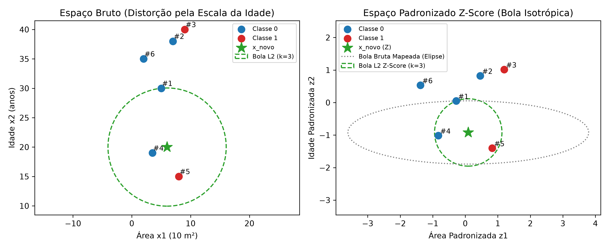
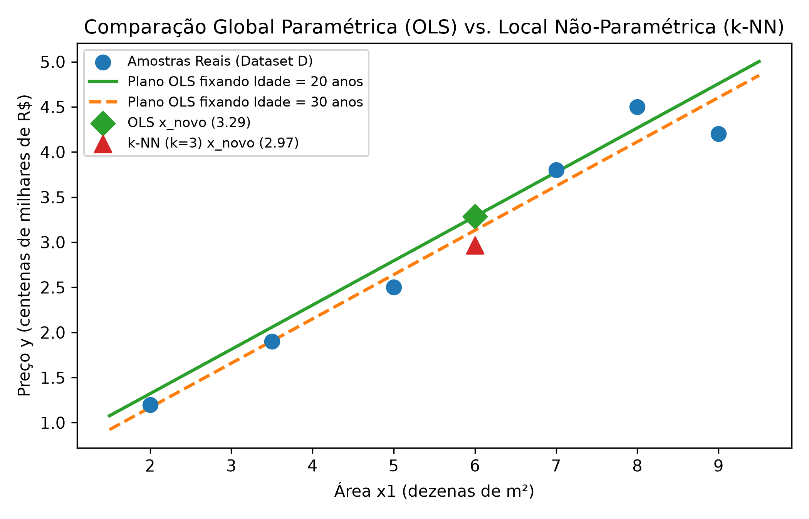
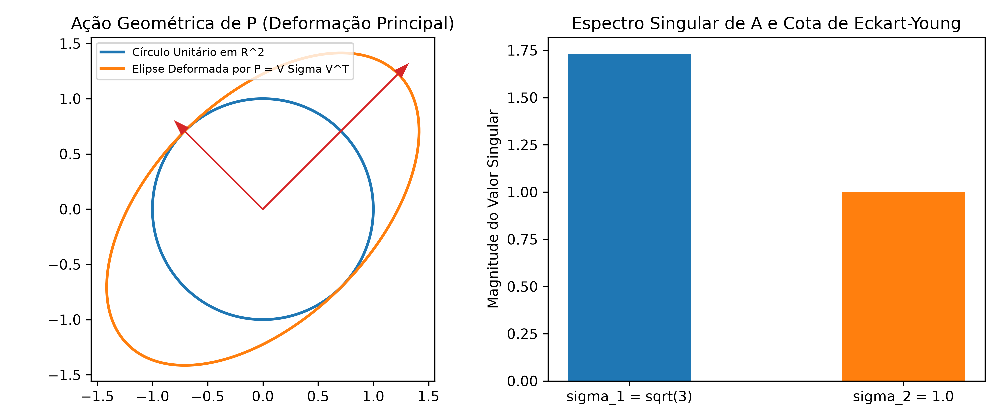
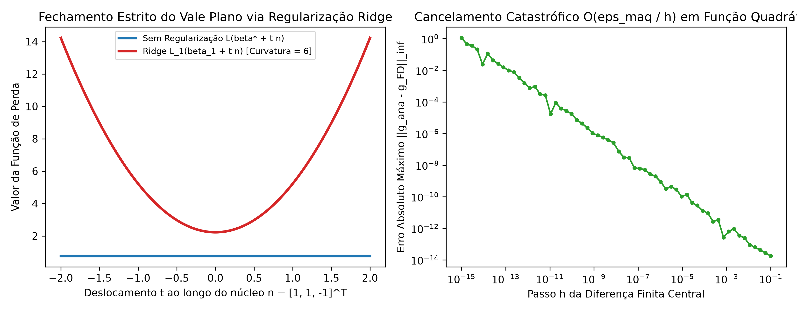
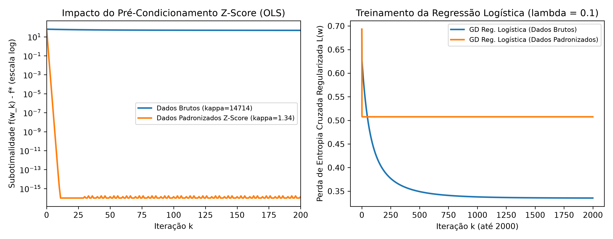
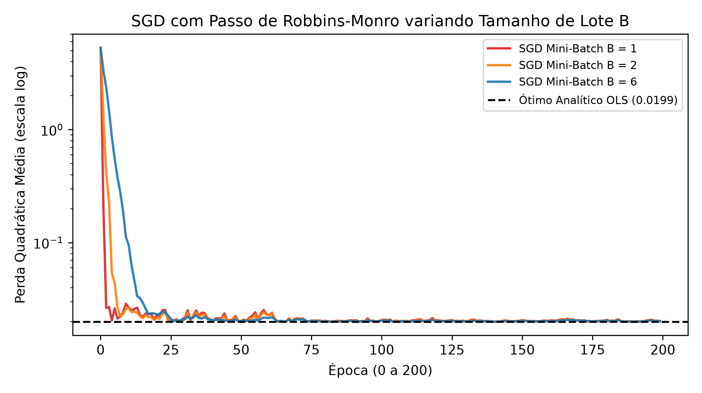
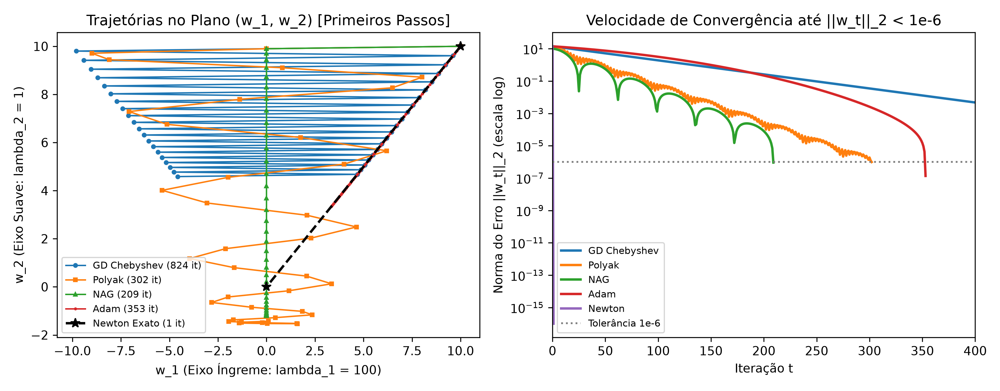
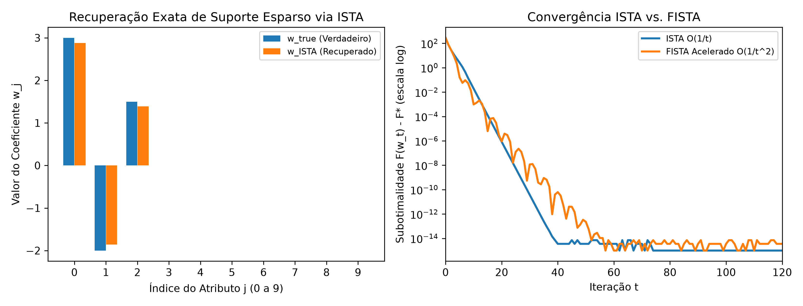

# Álgebra Linear e Otimização Contínua para Machine Learning (NumPy Puro)

Implementação exploratória, modular e reprodutível — construída **do zero exclusivamente em NumPy puro** (sem `scikit-learn`, `scipy.optimize` ou *frameworks* de diferenciação automática) — dos fundamentos matemáticos que governam estimadores clássicos de Aprendizado de Máquina, superfícies de perda e algoritmos modernos de otimização.

O objetivo do repositório é conectar diretamente **deduções algébricas e geométricas** (normas, projeções, decomposição espectral, SVD, Jacobianos/Hessianas, condicionamento e operadores proximais) a **implementações vetorizadas validadas numericamente** dentro de tolerâncias de ponto flutuante entre $`10^{-10}`$ e $`10^{-15}`$.

---

## Visão Geral da Arquitetura

```text
.
├── .python-version                        # Versão fixa do interpretador Python (3.13)
├── pyproject.toml                         # Dependências mínimas (numpy, matplotlib) gerenciadas via uv
├── uv.lock                                # Lockfile determinístico de ambiente
├── projeto_guia_algebra_otimizacao.ipynb  # Notebook interativo com experimentos e gráficos embutidos
├── figures/                               # Visualizações geradas automaticamente em 300 DPI
├── report/                                # Memorial técnico em LaTeX com provas formais completas
└── src/
    ├── datasets.py                        # Sistemas de dados canônicos (imobiliário, toy A/B e esparso)
    ├── questao1.py                        # Geometria métrica, escala de atributos e k-NN
    ├── questao2.py                        # Posto matricial, multicolinearidade e Mínimos Quadrados (OLS)
    ├── questao3.py                        # Projeção ortogonal, Teorema Espectral, SVD e Decomposição Polar
    ├── questao4.py                        # Cálculo matricial, Hessiana, vales planos e Regularização Ridge
    ├── questao5.py                        # L-suavidade, Chebyshev, pré-condicionamento Jacobi e Reg. Logística
    ├── questao6.py                        # SGD Mini-Batch (Robbins-Monro), Polyak, NAG, Adam e Newton
    ├── questao_bonus.py                   # Otimização não-suave, Soft-Thresholding, ISTA e FISTA (Lasso)
    └── main.py                            # Orquestrador da suíte completa de validações e gráficos
```

---

## Mecanismos Matemáticos e Resultados Experimentais

### 1. Geometria Métrica, Escala de Atributos e $`k`$-NN (`src/questao1.py`)

* **Mecanismo:** Investiga como métricas distintas ($`L_1`$, $`L_2`$, $`L_\infty`$ e Mahalanobis) medem proximidade em $`\mathbb{R}^2`$ sobre um conjunto imobiliário ($`N=6`$, atributos de área $`x_1 \in [2{,}0, 9{,}0]`$ e idade $`x_2 \in [15{,}0, 40{,}0]`$) e demonstra formalmente por que a dissimilaridade do cosseno $`d_{\cos}(\mathbf{u}, \mathbf{v}) = 1 - \frac{\langle \mathbf{u}, \mathbf{v}\rangle}{\lVert\mathbf{u}\rVert_2 \lVert\mathbf{v}\rVert_2}`$ **não é uma métrica formal** (violando a desigualdade triangular para $`\mathbf{u}=[1,0]^T`$, $`\mathbf{v}=[\frac{\sqrt{2}}{2},\frac{\sqrt{2}}{2}]^T`$, $`\mathbf{w}=[0,1]^T`$, pois $`1{,}0000 > 0{,}5858`$).
* **Impacto da Escala:** Como a variância amostral da idade ($`s_2^2 = 106{,}70`$) é $`14{,}47\times`$ maior que a da área ($`s_1^2 = 7{,}375`$), uma bola euclidiana no espaço bruto corresponde a uma elipse fortemente achatada no eixo padronizado da idade. Ao aplicar padronização Z-Score, o 1º vizinho mais próximo do ponto de consulta $`\mathbf{x}_{\text{novo}} = [6{,}0, 20{,}0]^T`$ inverte-se da **Amostra 4** ($`c_4=0`$) para a **Amostra 5** ($`c_5=1`$), alterando a predição do classificador $`1`$-NN; para $`k=3`$, a classe majoritária permanece $`0`$ e a regressão estima $`\hat{y}_{\text{novo}} = 2{,}9667`$.



---

### 2. Posto Matricial, Multicolinearidade e Mínimos Quadrados OLS (`src/questao2.py`)

* **Mecanismo:** Formula a matriz de design $`\mathbf{X} \in \mathbb{R}^{6 \times 3}`$ com termo de intercepto e verifica via Teorema de Rouché–Capelli que o sistema sobredeterminado $`\mathbf{X}\mathbf{w} = \mathbf{y}`$ é incompatível ($`\mathrm{rk}(\mathbf{X}) = 3 < 4 = \mathrm{rk}([\mathbf{X} \mid \mathbf{y}])`$). Ao introduzir uma coluna colinear artificial $`x_3 = 2{,}5x_1`$, o posto da matriz de Gram $`\tilde{\mathbf{X}}^T\tilde{\mathbf{X}} \in \mathbb{R}^{4 \times 4}`$ permanece $`3 < 4`$ (singular), tornando os pesos $`\hat{\mathbf{w}}`$ não-únicos ao longo do núcleo $`\mathcal{N}(\tilde{\mathbf{X}})`$, enquanto as predições $`\hat{\mathbf{y}} = \tilde{\mathbf{X}}\hat{\mathbf{w}}`$ permanecem estritamente únicas por projeção ortogonal.
* **Resultados:** A resolução das Equações Normais $`\mathbf{X}^T\mathbf{X}\hat{\mathbf{w}} = \mathbf{X}^T\mathbf{y}`$ (validada por Eliminação Gaussiana manual com pivoteamento parcial, `np.linalg.solve` e `np.linalg.lstsq`) fornece $`\hat{\mathbf{w}} = [0{,}646968,\; 0{,}490887,\; -0{,}015353]^T`$, com resíduo ortogonal $`\hat{\mathbf{e}} = \mathbf{y} - \mathbf{X}\hat{\mathbf{w}}`$ satisfazendo $`\lVert\mathbf{X}^T\hat{\mathbf{e}}\rVert_\infty = 4{,}086 \times 10^{-14} < 10^{-10}`$. Para $`\mathbf{x}_{\text{novo}}`$, o modelo global linear prediz $`\hat{y}_{\text{lin}} = 3{,}285237`$, capturando a tendência positiva da área em contraste com a média local do $`k`$-NN ($`2{,}9667`$).



---

### 3. Projeção Ortogonal, Teorema Espectral, SVD e Decomposição Polar (`src/questao3.py`)

* **Mecanismo:** Sobre o sistema sobredeterminado $`\mathcal{A} \in \mathbb{R}^{3 \times 2}`$ de posto completo, realiza a decomposição em soma direta $`\mathbb{R}^3 = \mathrm{Col}(\mathcal{A}) \oplus \mathrm{Col}(\mathcal{A})^\perp`$ via matriz de projeção idempotente e simétrica $`\mathbf{P} = \mathcal{A}(\mathcal{A}^T\mathcal{A})^{-1}\mathcal{A}^T`$, constrói manualmente a SVD reduzida $`\mathcal{A} = \mathbf{U}\boldsymbol{\Sigma}\mathbf{V}^T`$ a partir da decomposição espectral de $`\mathbf{S} = \mathcal{A}^T\mathcal{A}`$ e extrai a Decomposição Polar $`\mathcal{A} = \mathbf{O}\mathbf{P}_{\text{polar}}`$.
* **Resultados:**
  * Ortogonalidade do resíduo: $`\lVert\mathcal{A}^T\hat{\mathbf{e}}\rVert_\infty = 4{,}441 \times 10^{-16} < 10^{-14}`$.
  * Relação quadrática de condicionamento confirmada: $`\kappa(\mathbf{S}) = 3{,}0000 = [\kappa(\mathcal{A})]^2`$ (ilustrando por que métodos baseados em QR/SVD são numericamente superiores à formação explícita de $`\mathbf{X}^T\mathbf{X}`$).
  * Melhor aproximação de posto 1 (Teorema de Eckart–Young–Mirsky): $`\lVert\mathcal{A} - \hat{\mathcal{A}}^{(1)}\rVert_2 = \sigma_2 = 1{,}0000000000`$.



---

### 4. Cálculo Matricial, Vales Planos e Regularização Ridge (`src/questao4.py`)

* **Mecanismo:** Analisa a perda quadrática $`L(\boldsymbol{\beta}) = \lVert\mathcal{B}\boldsymbol{\beta} - \mathbf{y}_{\mathcal{B}}\rVert_2^2`$ sobre uma matriz $`\mathcal{B} \in \mathbb{R}^{3 \times 3}`$ com colinearidade exata ($`\mathbf{b}_3 = \mathbf{b}_1 + \mathbf{b}_2`$). O Jacobiano dos resíduos em *denominator layout* é $`\mathbf{J}_{\mathbf{r}}(\boldsymbol{\beta}) = \mathcal{B}^T`$, reproduzindo o passo reverso do *backpropagation* ($`\nabla L = \mathbf{J}_{\mathbf{r}}\nabla_{\mathbf{r}}g`$), e a Hessiana $`\nabla^2 L = 2\mathcal{B}^T\mathcal{B}`$ possui espectro $`\{0, 6, 42\}`$ — revelando um **vale plano** ao longo do núcleo $`\mathbf{n} = [1, 1, -1]^T`$.
* **Resultados:**
  * Ao longo de $`\boldsymbol{\beta}^* + t\mathbf{n}`$ ($`t \in [-2, 2]`$), a perda não regularizada permanece invariante em $`0{,}761905`$ (variação máxima `0.0`).
  * A penalização Ridge ($`\lambda = 1`$) desloca o espectro da Hessiana para $`\{2, 8, 44\} \succ 0`$, fechando o vale plano com curvatura estrita $`2\lambda\lVert\mathbf{n}\rVert_2^2 = 6`$ e definindo o minimizador global único $`\boldsymbol{\beta}_1 = [0{,}704545,\; 0{,}204545,\; 0{,}909091]^T`$.
  * A validação por diferença finita central ($`h = 10^{-5}`$) atinge erro máximo de $`1{,}048 \times 10^{-10}`$, demonstrando que o erro de truncamento $`\mathcal{O}(h^2)`$ é nulo em funções quadráticas e que desvios para $`h \to 0`$ decorrem de cancelamento catastrófico $`\mathcal{O}(\epsilon_{\text{máq}}/h)`$.



---

### 5. Condicionamento, Pré-Condicionamento de Jacobi e Regressão Logística (`src/questao5.py`)

* **Mecanismo:** Conecta $`L`$-suavidade e o Lema da Descida à dinâmica modal do erro na Descida do Gradiente, derivando a taxa ótima minimax de Chebyshev $`\alpha^* = \frac{2}{\lambda_{\max}+\lambda_{\min}}`$ e fator de contração $`\rho^* = \frac{\kappa-1}{\kappa+1}`$. Prova algebricamente que padronizar $`\mathbf{X}`$ via Z-Score equivale a aplicar o **Gradiente Pré-Condicionado diagonal de Jacobi** ($`\mathbf{M} = \mathbf{D}`$), transformando a Hessiana média na matriz de correlação de Pearson. Na Regressão Logística Binária com regularização $`L_2`$ ($`\lambda = 0{,}1`$), prova-se $`\nabla^2\mathcal{L}(\mathbf{w}) = \frac{1}{N}\mathbf{X}^T\mathbf{S}\mathbf{X} + 2\lambda\mathbf{I} \succeq 2\lambda\mathbf{I} \succ 0`$, garantindo estrita convexidade mesmo quando as classes são linearmente separáveis.
* **Resultados:**
  * A padronização Z-Score reduz o número de condição $`\kappa(2\mathbf{X}^T\mathbf{X})`$ de **`14 714,2235`** para **`1,3410`** (`ddof=1`) / **`1,2350`** (`ddof=0`).
  * Em 2000 iterações no OLS, a GD nos dados padronizados atinge exatamente o ótimo global ($`0{,}239147`$), enquanto nos dados brutos permanece em $`29{,}493202`$.
  * Na Regressão Logística ($`\lambda=0{,}1`$), a GD vetorizada converge ao mesmo ponto único do Método de Newton ($`\lVert\mathbf{w}_{\text{GD}} - \mathbf{w}_{\text{Newton}}\rVert_2 < 10^{-10}`$), com $`\hat{\mathbf{w}} = [-0{,}407885,\; 0{,}896095,\; -0{,}221284]^T`$ e **acurácia de $`100{,}0\%`$ ($`6/6`$)**.



---

### 6. Otimização Estocástica, Momento (Polyak/NAG), Adam e Newton (`src/questao6.py`)

* **Mecanismo:** Avalia a redução de variância do estimador de mini-batch ($`\mathrm{Var}(g_B) = \sigma^2/B`$) sob o cronograma de Robbins–Monro ($`\alpha_t = \frac{\alpha_0}{1+\gamma t}`$), além de comparar otimizadores de 1ª ordem e 2ª ordem na superfície quadrática mal condicionada $`f(w_1, w_2) = \frac{1}{2}(100w_1^2 + w_2^2)`$ ($`\kappa = 100`$) a partir de $`\mathbf{w}_0 = [10, 10]^T`$ até $`\lVert\mathbf{w}_t\rVert_2 < 10^{-6}`$.
* **Resultados Comparativos (Iterações até convergência para $`\lVert\mathbf{w}_t\rVert_2 < 10^{-6}`$):**

| Otimizador | Hiperparâmetros | Iterações | Comportamento Observado |
| :--- | :--- | :---: | :--- |
| **GD Chebyshev** | $`\alpha^* = 2/101`$ | `824` | Ziguezague transversal intenso ($`\rho^* = 99/101`$). |
| **Momento de Polyak** | $`\alpha = 0{,}01, \beta = 0{,}9`$ | `302` | Aceleração longitudinal com leve *overshooting* inercial. |
| **Nesterov (NAG)** | $`\alpha = 0{,}01, \beta = 0{,}9`$ | `209` | Gradiente antecipado atua como freio preditivo; mais rápido de 1ª ordem. |
| **Adam** | $`\alpha = 0{,}1, \beta_1=0{,}9, \beta_2=0{,}999`$ | `353` | Reescalonamento adaptativo coordenada a coordenada com correção de viés. |
| **Método de Newton** | Passo unitário $`\mathbf{H}^{-1}\nabla f`$ | **`1`** | Passo exato $`\mathbf{w}_1 = \mathbf{w}_0 - \mathbf{A}^{-1}(\mathbf{A}\mathbf{w}_0) = \mathbf{0}`$ independente de $`\kappa`$. |





---

### 7. Otimização Não-Suave, Operadores Proximais e ISTA/FISTA (`src/questao_bonus.py`)

* **Mecanismo:** Resolve o problema composto Lasso $`\min_{\mathbf{w}} \frac{1}{2}\lVert\mathbf{X}\mathbf{w} - \mathbf{y}\rVert_2^2 + \lambda\lVert\mathbf{w}\rVert_1`$ derivando o subdiferencial de $`|x|`$ e desacoplando o operador proximal no **limiar suave (*soft-thresholding*)** $`\mathcal{S}_{\gamma\lambda}(v_i) = \mathrm{sign}(v_i)\max(|v_i| - \gamma\lambda, 0)`$, que anula exatamente qualquer coordenada com $`|v_i| \le \gamma\lambda`$. Compara a convergência sublinear $`\mathcal{O}(1/t)`$ do ISTA com a aceleração $`\mathcal{O}(1/t^2)`$ do FISTA.
* **Resultados:** Em um problema sintético esparso ($`N=50, d=10`$, $`\mathbf{w}_{\text{true}} = [3{,}0, -2{,}0, 1{,}5, 0, \dots, 0]^T`$ com ruído $`\sigma = 0{,}05`$ e $`\lambda = 5{,}0`$), o algoritmo recupera **100% do suporte verdadeiro `[0, 1, 2]`**, zerando rigorosamente **7 de 7** coeficientes espúrios.



---

## Como Utilizar e Executar o Projeto

O ambiente é gerenciado de forma determinística via **`uv`**.

### Pré-requisitos
* Python $`\ge 3.11`$ (configurado para `3.13` em [`.python-version`](.python-version))
* [`uv`](https://docs.astral.sh/uv/) instalado no sistema

### Passo a Passo de Execução

```bash
# 1. Sincronizar dependências exatas a partir do uv.lock
uv sync

# 2. Executar toda a suíte de validação numérica, asserções e geração de gráficos em figures/
uv run python src/main.py

# 3. (Opcional) Executar módulos individuais separadamente
uv run python src/questao1.py
uv run python src/questao2.py
uv run python src/questao3.py
uv run python src/questao4.py
uv run python src/questao5.py
uv run python src/questao6.py
uv run python src/questao_bonus.py

# 4. (Opcional) Abrir ou reexecutar o notebook interativo
uv run python -m jupyterlab projeto_guia_algebra_otimizacao.ipynb
# ou via nbconvert:
uv run python -m nbconvert --to notebook --execute --inplace projeto_guia_algebra_otimizacao.ipynb
```

Todas as sementes aleatórias estão fixadas (`np.random.seed(42)` / `np.random.default_rng(42)`), assegurando reprodutibilidade integral de métricas, pesos e gráficos.
